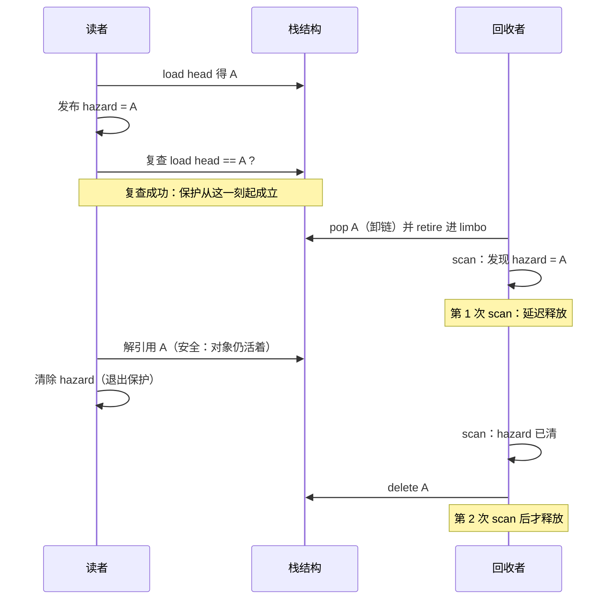

# 第 77/208 课：ABA与安全内存回收

## 元信息

| 项目 | 内容 |
| --- | --- |
| 阶段 | 第 5 阶段 · 并发数据结构 |
| 前置 | e-lockfree、b-lifetime |
| 难度 | 专家 |
| 领域 | E |
| 标签 | Memory Reclamation、E、C++ |
| 子分类 | 并发数据结构 |
| 节点 ID | e-reclaim |
| 英文名 | Memory Reclamation |

> 承接说明：前置节点 e-lockfree（无锁进展保证与CAS结构，第 76 课）讲了三种进展保证、线性化点、CAS 失败后的重试与退避，把“把 mutex 换成 CAS”拆成进展、正确性、性能三个问题来讨论，并在结尾点名：正确性还要求内存回收——但第 76 课用固定槽位 SPSC 环形队列巧妙地避开了动态节点的释放问题。前置节点 b-lifetime（对象生命周期与存储期，第 19 课）讲了对象生命周期结束之后再访问就是未定义行为：`delete` 之后再去碰那块内存，就是 use-after-free。本课把这两条线拧到一起：动态节点的无锁结构（Treiber 栈、无锁链表）里，CAS 只比较当前值，地址被回收复用就可能产生 ABA；同时，被并发访问的对象必须延迟到所有读者安全离开之后再释放。“无锁”只是表——账本如何记账、旧账何时作废，才是本课要解决的两件事。

---

## 导读

第 76 课结束时留了一个尾巴：SPSC 队列“不需要处理动态节点回收”，靠固定槽位绕开了这一整类问题。本课就来直面它。一旦结构里出现了 `new Node()` 和 `delete`，两个新问题立刻浮出水面：

1. **ABA**：CAS 只比较“当前值是否等于期望值”。一个指针曾经是 A、被换成了 B、又被换回 A，CAS 眼里这三步毫无差别。但栈结构在这三步之间可能已经面目全非——节点被弹出了、释放了、地址还被复用了。CAS 成功，数据结构已经坏了。
2. **安全回收**：一个线程刚 `delete` 了节点 A，另一个线程手里还拿着 A，正要去解引用。这不是 ABA 这种“逻辑错误”，而是直接崩溃或静默读到垃圾的 use-after-free。

这两个问题看起来无关，其实纠缠在一起：为了防 ABA 人们给指针加版本号，但版本号挡不住“CAS 之前就需要解引用旧节点”的那一步；为了安全回收，读者需要向回收者声明“我正在用这块内存”，这就是本课的两位主角——**hazard pointer** 和 **epoch-based reclamation（EBR）**，它们分别对应 Linux RCU 概念文档里的两种回收思路的近亲。

本节点的 summary 值得放在眼前反复读：

> CAS 只比较当前值，地址回收复用可能产生 ABA；并发访问中的对象需延迟到所有读者安全后释放。

放在微信公众号后台的业务语境里，这三件事随时都在发生：

1. **配置/路由表热更新**：路由表读多写少，改写频率可能每秒几次，但每个请求都要查表。读线程拿着旧表的指针正在扫描，写线程不能立刻 `delete` 旧表——它不知道有多少读者刚拿到旧指针。RCU 式的思路就是“先换表指针，旧表等所有读过它的读者走完再删”。换表本身很短，等待读者反而很长，这正是“延迟回收”的语义。
2. **连接/会话对象被异步回调引用**：一个连接对象被登记进了定时器回调、消息重试队列、统计聚合器。主循环判定连接关闭，顺手 `delete` 了它；三毫秒后，一个还排在队列里的回调拿着这个指针进来用——隐蔽的 use-after-free，在压测里“偶现”，在线上“复现不出”。
3. **无锁空闲链表（freelist、内存池）**：用 Treiber 栈管理空闲块的内存池，节点进进出出、地址反复复用，是 ABA 最经典的温床。pop 时 CAS 因为地址“看起来没变”而成功，把两个本来独立的空闲块串成了一条假链。

本课的路线很简单，沿着 3 个节点要点走：

- **ABA 与版本标签**：用 Treiber 栈复现经典 ABA，讲清版本号为什么能挡住错误的 CAS、却挡不住 CAS 之前的解引用。
- **hazard pointers 与 epoch**：读者如何向回收者“发出使用声明”，两种方案各自的成本与回收上界。
- **停滞线程和回收延迟**：延迟回收把线下移到了工程层面，停滞线程如何让待回收内存无限膨胀。

一个重要的边界要在开头就说清楚：**本课给出的 hazard、epoch 实现是“教学版”，只求逻辑自洽、可编译、能跑通实验，用来建立直觉；生产中优先用成熟实现**（folly 的 hazptr、liburcu，以及 C++26 提案中出现的 `hazard_pointer` / `rcu` 方向——注意是提案/新标准方向，具体形态以标准演进为准）。社会在并发原语上犯的学费，多数比工程师自己的学费贵，遵守前人的账。

---
## 学习目标

### goals

- 能解释 ABA 与版本标签。
- 能独立完成：用可控调度复现 ABA 和提前释放，画出 hazard 保护的时序。

### acceptance

- 能证明读者完成前对象不释放。
- 报告 epoch 中停滞线程的内存风险。

和第 76 课一样，把验收翻译成可检查的产物：

- **“能证明读者完成前对象不释放”**：不是“跑了没崩”，而是一个可写的论证。读者按“读 head → 发布 hazard → 复查 → 解引用”走时，分两种情况讨论：如果回收者的 `retire` 早于读者发布 hazard，读者的复查就会失败、不会用这个指针；如果 `retire` 晚于读者复查成功，那么回收者之后任何一次 scan 都会看到这个 hazard，把节点留在 limbo 列表里。两种情况合起来：读者清除 hazard 之前，节点不可能被 delete。本课的实践部分会用日志把这个论证变成可打印的事实：你会在输出里看到“第 1 次 scan 看到 hazard → 延迟释放”，而读者输出“读取 value=…，安全读完”发生在“第 2 次 scan → delete”之前。
- **“报告 epoch 中停滞线程的内存风险”**：跑通本课的 EBR 停滞实验——一个读者在临界区里 `sleep`，写者持续 retire 并打印 limbo 长度，用 `ps` / `/proc/<pid>/status` 观察进程 RSS 的增长，然后读者退出、limbo 回落。要求你能把观察到的现象翻译成风险陈述：**一个停滞读者可以钉住整条回收流水线**，limbo 无限增长、内存上涨，最终可能 OOM；hazard pointer 下同样场景只钉住它保护的少数节点。

### 先修自检

- e-lockfree：能解释 CAS 的语义、写出“load → 计算 → CAS，失败重试”的循环，理解为什么说“第 76 课的结构能跑”不代表“每个节点都可以立刻 delete”。
- b-lifetime：能说出 `delete p; p->next` 错在哪一层——不是“可能出错”，而是对象生命周期结束后的任何解引用都是未定义行为，ASan 会报 heap-use-after-free。

---

## 为什么后端要懂

本节点给出的 why 是：**避免无锁链表的隐蔽 use-after-free。**“隐蔽”两个字才是重点——这类 bug 的共同味道是：小流量、特定调度下才触发，压测压不出来，线上偶现一次，回放复现不了。下面把公众号后台的三类真实场景各展开一层。

### 1. 配置/路由表热更新：读多写少表的最短换锁路径

后台的菜单配置、路由规则、灰度开关这类表，特征是**读路径每秒成千上万次，写路径一天几十次**。最朴素的方案是读写锁：读者拿 shared 锁。但读写锁有真实的成本：读者要进内核写一次 reader 计数、写者要独占等待、读者在临界区里一旦被调度走，写者就要排队。

RCU/hazard 式思路给了另一条路：读者只做“把当前表指针读进本地 + 声明我在读”，写者换掉全局指针，旧表**不立刻 delete**，挂进待回收列表，等所有可能读它的读者离开读端临界区后再删。读路径没有锁、没有原子递增竞争（或只有一个 `store`），代价转移到写路径和回收侧。

这正是“延迟回收交换锁”的交换：读路径变便宜，代价是**你必须证明旧表在所有读者安全离开后才会消失**——这就是本课 hazard/epoch 要解决的问题。搞反了糟糕程度更高：一边换掉了读锁，一边 `delete` 旧表，读线程拿着旧表指针崩溃在生产环境。

### 2. 连接/会话对象：被异步回调引用时的提前释放

后台推送模块里有大量异步回调：定时器（检查连接心跳）、重试队列（延迟重发）、统计聚合（上报活跃会话）。连接生命周期归主循环管理，回调只是“手里拿着一个 `Conn*`”。如果主循环关闭连接时直接 `delete`，手里拿着指针的回调就是丁字路口——事故表现为随机崩溃，而 ASan/TSan 也许才能告诉你真相，如果那块内存连续几轮都没被复用，甚至什么都测不出来（现代分配器上 UAF 有很大概率“没崩但数据是垃圾”）。

本课 API 思路的教训是：**发现代码里存在“某把锁保护着指针，另一处无锁引用它”的结构，就要问一句：谁保证引用者释放之前，生命周期结束后对象还活着？**要么引用计数（`shared_ptr`/`atomic<shared_ptr>`，代价见误区一节），要么延迟回收，要么明确“回调拿到的指针只在一小段同步窗口内合法”的契约。没有契约的悬垂指针，不是设计问题，是事故预告。

### 3. 无锁 freelist/内存池：ABA 最温床的产地

用 Treiber 栈管理空闲块的内存池非常诱人：没有 mutex、没有计数器、push/pop 都是常数次 CAS。但 freelist 有两个别的结构没有的“加速 ABA”特性：

- **节点地址必然复用**：空闲块出栈（分配）又入栈（归还），同一地址反复回到栈顶。ABA 里“B 变回 A”这一步，在链表结构里需要巧妙的调度，在 freelist 里是每天都在发生的日常。
- **结构可能已经变了**：A 出栈又入栈后，`A->next` 早已从 B 换成了 nullptr（或者别的块），而 pop 的第二步读的 `next` 可能是几分钟前、别人改链之前的旧值。

本课要点一会用可控调度把这个场景拍在桌面上：CAS 成功的那一刻，栈顶已经指向一个“早就被弹出”的节点。

### 4. 一句话总结方向

这三个场景共享同一个判断框架：

- 读路径要不要付锁的代价？读多写少时，延迟回收是很好的选项。
- 每次读是真的都是“读取一个短暂声明”的窗口吗？发起一次发布/校验/退出流程，孤立于对象生命周期。
- 谁赎回旧对象？需要一个**可证明**的机制，而不是“大概没人还在用吧”。

---
## 要点一：ABA 与版本标签

### 先把 pop 的三步撕开看

Treiber 栈的 pop 是 CAS 重试循环：

```cpp
Node* pop() {
    for (;;) {
        Node* head_old = head_.load();       // 步骤 1：读到 A
        if (head_old == nullptr) return nullptr;
        Node* next = head_old->next;         // 步骤 2：读到 B（A->next）
        Node* expected = head_old;
        if (head_.compare_exchange_weak(     // 步骤 3：CAS(head, A, B)
                expected, next)) {
            return head_old;                 // A 弹出成功
        }
        // CAS 失败，重试
    }
}
```

步骤 3 的语义是“**如果**当前值还等于我刚才看到的值，**才把它换成** B”。CAS 只比较当前值这一个点，它不知道也不需要知道中间发生了什么。**“中间发生了什么”就是 ABA 的舞台。**

### 经典 ABA 的逐步时序表

初始状态：栈 `head -> A -> B -> nullptr`（A、B 都是堆上节点）。线程 1 正在 pop，走到步骤 2 完成、还没执行步骤 3 时，被调度器挂起。

| 步 | 线程 1 | 线程 2 | 栈状态（head → …） |
| --- | --- | --- | --- |
| 0 | — | — | `A → B → ∅` |
| 1 | 读 `head` 得 A | — | `A → B → ∅` |
| 2 | 读 `A->next` 得 B | — | `A → B → ∅` |
| 3 | **被挂起** | — | `A → B → ∅` |
| 4 | 挂起中 | CAS(head, A, B) 成功，A 弹出 | `B → ∅` |
| 5 | 挂起中 | CAS(head, B, ∅) 成功，B 弹出 | `∅` |
| 6 | 挂起中 | 把 A 重新入栈（A->next = ∅） | `A → ∅` |
| 7 | 挂起中 | delete A（或交给回收者） | `A → ∅`（A 已不在结构语义上属于一个有效弹出的节点） |
| 8 | 恢复：CAS(head, A, **B**) | — | CAS 成功（head 现在确实等于 A！） |
| 9 | — | — | `B → ∅`：**head 指向已经弹出的 B** |

灾难在第 8 步：线程 1 想做的事是“把 A 摘下来、接上 A原来的 next（B）”。但从线程 1 挂起到恢复的这段时间里，世界已经变了——A 被弹出了、B 也被弹出了、A 又被推回去了，而线程 1 对这一切一无所知。CAS 的期望值 A “恰好”又等于当前值，于是成功，而成功做的事是完全错误的：把一个已经弹出/释放的 B 接回栈顶，同时真正应该交接的 A->next（现在是 ∅）被丢掉。

注意第 4~6 步即使没有第 7 步的 delete，也一样坏：head 变成了 B，而 B 早在第 5 步就被弹出了。**ABA 不需要地址复用到“堆回收再分配”，freelist 里同一节点重新入栈就足够触发。**第 7 步的另一层意思在要点二的误区里展开。

### 为什么说 ABA 是“逻辑正确性”问题而不是“奇怪的巧合”

第 76 课讲过 CAS 重试循环的线性化点：pop 的线性化点在 CAS 成功的那一瞬间。ABA 出现时，成功的那一刻对应的**实际语义**（弹出一个刚被别人弹出的节点、把废节点接上）和**期望语义**（弹出栈顶）完全对不上——结构已经越过了任何合法的串行历史。这不是竞态“概率上可容忍”，从那一刻起，数据的结构保证已经丢失，后续任何操作都建立在坏结构上。

### 版本标签：把“没变”变成“自生成以来没被改过”

修复思路把“比较指针”升级为“比较（指针, 版本号）”的对。版本号单调递增，任何一次成功的修改都会推进它；指针地址复用回 A，版本号不会复用：

```cpp
#include <atomic>
#include <cstdint>
#include <cstdio>

struct Node {
    int value;
    Node* next;
};

// “指针 + 单调版本号”打包成 128 位（对齐后的 struct，
// 平台上作为 double-width 存储）
struct TaggedPtr {
    Node* p;
    std::uint64_t tag;  // 版本号，每次成功写都 +1
};

class TaggedStack {
public:
    TaggedStack() : head_(TaggedPtr{nullptr, 0}) {}

    // 平台核对：64 位平台上 sizeof(TaggedPtr) == 16，
    // 一个 atomic<TaggedPtr> 是否 lock-free 依赖平台的
    // cmpxchg16b（x86-64 上编译需 -mcx16）。
    // 承接第 76 课：用 is_lock_free() 核对第一个环节。
    bool lock_free_probe() const { return head_.is_lock_free(); }

    void push(Node* n) {
        for (;;) {
            TaggedPtr old = head_.load(std::memory_order_acquire);
            n->next = old.p;
            TaggedPtr neu{n, old.tag + 1};           // push 推进版本
            if (head_.compare_exchange_weak(old, neu,
                                            std::memory_order_release,
                                            std::memory_order_acquire)) {
                return;
            }
        }
    }

    Node* pop() {
        for (;;) {
            TaggedPtr old = head_.load(std::memory_order_acquire);
            if (old.p == nullptr) return nullptr;
            Node* next = old.p->next;    // 注意：这一步仍是 UAF 风险，见后文
            TaggedPtr neu{next, old.tag + 1};        // pop 也推进版本
            if (head_.compare_exchange_weak(old, neu,
                                            std::memory_order_release,
                                            std::memory_order_acquire)) {
                return old.p;
            }
            // tag 不匹配 → CAS 失败 → 重试。ABA 到这里被挡住。
        }
    }

private:
    std::atomic<TaggedPtr> head_;
};
```

还有一个常见写法：**在指针的空闲位塞版本号**。64 位平台上真实地址通常只用低 47/48 位，可以做高 16/17 位未使用，把一个很小的计数塞进去。这种技巧依赖“地址只需几位”的硬件假设、以及**必须保证塞位数没有超出分配器输出的地址范围**，可移植性差，一般只在针对性极其明确的内核式代码里使用；用户态更常见的做法是上面这种独立的 `tag` 字段。

### 版本号挡不住的那一步——本节点 pitfalls 原文

> 加版本号不能自动解决访问已释放内存的问题。

具体到上面的代码：`pop()` 的步骤 2 `Node* next = old.p->next;` 发生在 CAS **之前**。回到时序表：如果线程 2 在线程 1 挂起期间 delete 了 A，那么线程 1 恢复后第一个动作——读 `A->next`——**那次解引用本身就是 use-after-free**。ASan 能立即报出来，而版本号的保护发生在它之后的 CAS 上：**版本号让错误的 CAS 失败、挡住错误的结构更新，但它挡不住失败之前的那次解引用。**

一句话划界：

- **ABA 是“结构被错误地更新”问题**——用 tag/版本号修复。
- **过早释放是“在生命周期结束后访问对象”问题**——需要安全内存回收（hazard pointer、epoch、RCU），版本号**不是**安全回收。

这两个问题常被混成一句“ABA 难”。本课把它们的分界线钉死：**问题是两件事，修复也是两件事。**本课实践第三步会做实验验证这一点：tagged 栈在 ABA 调度下 CAS 失败（修复了第一件事），而在 delete 调度下仍然报 heap-use-after-free（第二件事照旧发生）。

---
## 要点二：hazard pointers 与 epoch

版本号解决了“结构别被错误更新”，但“什么时候才允许 delete”还没有答案。安全内存回收的所有方案，本质都是回答同一个问题：

> 回收者怎么知道，此刻没有任何读者还拿着这个指针？

两种经典答案：**读者公布自己正在用谁**（hazard pointer），以及**一个时间段里用过的东西打包结账**（epoch）。先把各自的机制讲清，再看它们在 ABA 修复里的位次。

### hazard pointer：读者公布，回收者核对

核心协议只有三句话：

1. **读者公布**：我要保护指针 A，把 A 写进我的（线程专属）hazard 槽。
2. **回收者核对**：retire 下来的节点先放 limbo 列表，定期 scan 所有 hazard 槽，只 delete 无人保护的节点。
3. **读者离开**：用完把槽清空，节点之后就能被回收。

但只有这三句话有一个致命漏洞：读者“读到 head”和“写 hazard”之间有个窗口，节点可能在窗口里被回收者读到了 head、判定没人用、delete 掉了。所以必须有第四句：

4. **读者复查**：写完 hazard 之后，**重新读一次 head**，确认还是 A，才允许解引用。

为什么必须复查？拆开看两个方向：

- **复查失败的含义**：发布 hazard 时 head 已经不是 A 了 → A 可能在“我读到 head”和“我发布 hazard”之间被弹出、retire 甚至释放。此时读者手里的 A 是脏的，必须丢弃重来，绝不能解引用。
- **复查成功的含义**：此刻 head 仍是 A。往前看，任何一次稍后（本次读 head 之后，建立健全序）发生的 scan，都会看到我槽里的 A——会推迟删除它。**所以从这一刻起，A 一定不会再被“偶然”释放。**

把保护方向记成一张卡：保护动作必须**先于**解引用发生，并且**经由对全局态的复核**确认保护没有被抢先放走对象。

### 教学版 hazard 实现

约束先写清楚：固定线程数、每个线程绑一个槽位、retire/scan 用一把互斥锁串行化（真实实现是多线程、per-thread retire 列表、永远不用全局大锁；这里是为了让协议本身尽可能少被实现细节遮住）。教学上全部使用 `seq_cst`——发布、复查、清空、scan 构成一个三方协议，用最强的默认内存序，讲解时不必逐处论证内存序插曲，也不会踩错；真实实现的精确内存序（acquire/release 的分段加固），等你读 folly hazptr 源码或论文时再学。

```cpp
// hazptr_simple.cpp —— 教学版 hazard pointer：协议本身，不是生产实现
// g++ -std=c++17 -pthread -O2 hazptr_simple.cpp && ./a.out
#include <algorithm>
#include <atomic>
#include <cstdio>
#include <mutex>
#include <vector>

struct Node {
    int value;
    Node* next;
};

namespace simple_hp {

constexpr int kMaxThreads = 8;
constexpr std::size_t kRetireThreshold = 8;   // 攒够这么多个才 scan 一次

class HazardDomain {
public:
    // 槽位初始化：atomic 数组默认不清零，显式写一遍
    HazardDomain() {
        for (auto& h : hazard_) {
            h.store(nullptr, std::memory_order_seq_cst);
        }
    }

    // 每个线程在启动时绑定一个属于自己的槽位
    void bind(int slot) {
        slot_ = slot;
        hazard_[slot_].store(nullptr, std::memory_order_seq_cst);
    }

    // 读者侧：受保护地读 head
    Node* acquire_protected(std::atomic<Node*>& head) {
        for (;;) {
            Node* p = head.load(std::memory_order_seq_cst);   // (1)
            if (p == nullptr) {
                hazard_[slot_].store(nullptr, std::memory_order_seq_cst);
                return nullptr;
            }
            hazard_[slot_].store(p, std::memory_order_seq_cst);   // (2) 发布
            // (3) 复查：为什么必须？
            //   在 (1)-(2) 之间，p 可能已被别的线程 pop 出去并 retire。
            //   若在 (1)-(2) 之间有 scan 发生，那次 scan 看不到 p 的 hazard，
            //   p 可能已被 delete——这时必须放弃 p、重来。
            //   复查通过 == 建立了一个先后事实：
            //   从本次复查起，任何晚于本次发布的 scan 都排在发布之后，
            //   之后任何 scan 都排在 (2) 之后，必然看见 p 被我保护。
            if (head.load(std::memory_order_seq_cst) == p) {  // (3)
                return p;    // 现在解引用 p 才是安全的
            }
            // 复查失败：回到循环，从 (1) 重来
        }
    }

    // 读者侧：读端临界区结束，保护解除
    void release() {
        hazard_[slot_].store(nullptr, std::memory_order_seq_cst);
    }

    // 回收者侧：把节点挂进待回收列表
    void retire(Node* victim) {
        std::lock_guard<std::mutex> g(rmu_);
        limbo_.push_back(victim);
        std::printf("[retire] %p 挂入 limbo，当前积压 %zu 个\n",
                    (void*)victim, limbo_.size());
        if (limbo_.size() >= kRetireThreshold) {
            scan_locked();
        }
    }

private:
    // 要求：持有 rmu_ 调用
    void scan_locked() {
        // 先给所有 hazard 槽拍快照
        std::vector<Node*> protected_now;
        for (auto& h : hazard_) {
            Node* p = h.load(std::memory_order_seq_cst);
            if (p != nullptr) protected_now.push_back(p);
        }
        // 对照 limbo：没人保护的才允许 delete
        std::vector<Node*> still;
        for (Node* v : limbo_) {
            if (std::find(protected_now.begin(), protected_now.end(), v)
                    != protected_now.end()) {
                still.push_back(v);      // 仍被保护，下轮再试
                std::printf("[scan] %p 仍被 hazard 保护，暂缓释放\n",
                            (void*)v);
            } else {
                std::printf("[scan] %p 无人保护，本轮回收\n", (void*)v);
                delete v;
            }
        }
        limbo_.swap(still);
    }

    int slot_ = 0;
    std::atomic<Node*> hazard_[kMaxThreads];
    std::mutex rmu_;
    std::vector<Node*> limbo_;
};

} // namespace simple_hp
```

教学版省掉了什么？至少三件事，读生产源码时要回来对照：

1. **per-thread retire 列表**：真实实现里每个线程维护自己的待回收列表，缓解集中锁的压力；
2. **精确内存序**：`acquire_protected` 与 scan 之间用 acquire/release 就够，`seq_cst` 是教学便利；
3. **生命周期管理**：线程退出时槽位要释放回池，避免槽位数量随线程数增长失控。

---

### epoch-based reclamation：读者结账，epoch 推进

hazard pointer 是“逐个指针声明保护”。epoch 的思路换了一级抽象：**不逐个声明，给整个读端临界区打时间标签**。

机制拆开是四件事：

1. **全局 epoch**：一个全局单调计数器，由回收者（或任何一个愿意推进它的线程）往上推。
2. **读端临界区**：读者进入时“宣告”——我现在处于临界区、看到的是当时那个 epoch 值；退出时解除宣告。宣告动作本身极便宜（两次 `store`）。
3. **limbo 列表**：回收者删除节点时不直接 `delete`，而是按“退役时的 epoch”分桶挂进 limbo（逍遥法外名单）。
4. **推进与结账**：只有当**所有活跃读者都已越过某个 epoch**——要么退出了临界区，要么进来时宣告的 epoch 已经不早于它——那个 epoch 之前的桶才允许整批释放。

直觉是“双方分头记账”：读者只做一件事——进出时打个时间戳；回收者只做一件事——检查“现在还有没有读者停留在足够老的 epoch”。只要没有，那一批旧节点就铁定没人引用了，因为**任何可能读到它们的读者，其时间戳必然停留在那个 epoch 或更早**，而“更早”就意味着它还挂在临界区里没有打完卡、会阻塞推进。

这个结构和 Linux RCU 的概念一一对应（更完整的对应关系在本课末尾 sourceStudy 一节展开）：

| 本课/用户态叫法 | Linux RCU 文档中的角色 | 负责什么 |
| --- | --- | --- |
| 读端临界区 enter/leave | `rcu_read_lock()` / `rcu_read_unlock()` | 读者宣告“我在读旧对象”，进/出 |
| 全局 epoch 推进 | grace period（宽限期） | 等待“读端临界区区间早于删除动作”的所有读者结束 |
| 同步推进 + 释放 | `synchronize_rcu()` | 阻塞等待宽限期结束后返回 |
| 推进 + 后台释放 | `call_rcu()` | 注册回调，宽限期结束后在软中断/工作队列里释放 |

但有一点必须立刻钉住（这正是本节点 sourceStudy 强调的）：**不要把内核 RCU 接口直接等同用户态实现**。内核的 RCU 能便宜，很大一部分原因是它扎根于调度器：抢占、idle、上下文切换这些被内核精确掌控的事件天然就是“读者静止点”，宽限期判定可以搭调度器的便车。用户态没有这层便利，宣告、推进、判定全部要自己做（liburcu 这类库做的事情就是把这些补齐；本课不展开 liburcu 内部细节，只保证你理解机制的边界）。

### 教学版 epoch 实现

和 hazard 一样给约束：固定槽位数、再用一把互斥锁串行化 retire 与释放（真实实现使用 per-thread 结构和无锁桶，这里为了看清协议）。教学上仍用 `seq_cst`。

```cpp
// epoch_simple.cpp —— 教学版 epoch-based reclamation：协议骨架，不是生产实现
#include <atomic>
#include <cstdint>
#include <mutex>
#include <utility>
#include <vector>

struct Node {
    int value;
    Node* next;
};

namespace simple_ebr {

constexpr int kNumSlots = 8;   // 参与线程数上限
constexpr int kNumBuckets = 2; // 双桶：node 按“退役 epoch”分桶

class EpochDomain {
public:
    void bind(int slot) { slot_ = slot; }

    // ---- 读端 ----
    // 进入临界区：宣告“我在临界区，我看到的 epoch 是 X”
    void enter_critical() {
        // 顺序重要：先声明“正在临界区内”，再登记看到的 epoch。
        // 若先登记后声明，中间出现的推进可能把“旧观察者”漏判为“已结账”。
        in_crit_[slot_].store(true, std::memory_order_seq_cst);
        seen_[slot_].store(global_.load(std::memory_order_seq_cst),
                           std::memory_order_seq_cst);
    }

    void leave_critical() {
        in_crit_[slot_].store(false, std::memory_order_seq_cst);
    }

    // ---- 回收端 ----
    // 退役：按当前全局 epoch 分桶挂入 limbo。
    // 锁内重读 global：若把 epoch 读在锁外，可能出现
    // “CAS 已推进、而本节点仍按旧值分桶”的竞争，
    // 导致新落桶者恰好撞进本轮即将释放的桶。
    void retire(Node* n) {
        std::lock_guard<std::mutex> g(mu_);
        std::uint64_t cur = global_.load(std::memory_order_seq_cst);
        limbo_[cur % kNumBuckets].push_back({cur, n});
    }

    std::size_t limbo_size() {
        std::lock_guard<std::mutex> g(mu_);
        return limbo_[0].size() + limbo_[1].size();
    }

    // 推进全局 epoch；成功推进后，释放上一个 epoch 的桶。
    // 返回是否成功推进了。
    bool try_advance_and_reclaim() {
        std::uint64_t cur = global_.load(std::memory_order_seq_cst);
        // 所有处在临界区内的读者，必须已经“见过”cur，
        // 否则它们可能还引用着 cur 落桶之前的更旧对象
        for (int i = 0; i < kNumSlots; ++i) {
            if (in_crit_[i].load(std::memory_order_seq_cst) &&
                seen_[i].load(std::memory_order_seq_cst) != cur) {
                return false;   // 有读者还在观察旧 epoch，先不推进
            }
        }
        if (!global_.compare_exchange_strong(cur, cur + 1,
                                             std::memory_order_seq_cst)) {
            return false;
        }
        // 推进到 cur+1。此时所有读者要么已出临界区，
        // 要么进来时看到的 epoch 已是 cur。
        // 可以释放桶（cur-1）中退役 epoch 不晚于 cur-1 的节点。
        // （cur 从 1 起，保证 cur-1 不发生无符号回绕）
        auto* old_bucket = &limbo_[(cur - 1) % kNumBuckets];
        std::lock_guard<std::mutex> g(mu_);
        std::vector<std::pair<std::uint64_t, Node*>> still;
        for (auto& [e, n] : *old_bucket) {
            if (e <= cur - 1) {
                delete n;                  // 结账：确属“两个 epoch 前”的垃圾
            } else {
                still.push_back({e, n});   // 新落桶者，留给下一轮
            }
        }
        old_bucket->swap(still);
        return true;
    }

private:
    int slot_ = 0;
    std::atomic<bool> in_crit_[kNumSlots];
    std::atomic<std::uint64_t> seen_[kNumSlots];
    std::atomic<std::uint64_t> global_{1};
    std::mutex mu_;
    std::vector<std::pair<std::uint64_t, Node*>> limbo_[kNumBuckets];

public:
    EpochDomain() {
        for (auto& b : in_crit_) b.store(false, std::memory_order_seq_cst);
        for (auto& s : seen_) s.store(0, std::memory_order_seq_cst);
    }
};

} // namespace simple_ebr
```

诚实声明这个教学版的简化（完整实现复杂得多，这里只为看得懂实验）：

1. **双桶够用在本实验的观测范围**：生产实现（liburcu、folly EBR、内核 RCU 的变体）扩展到更多 epoch 与无锁桶，并且处理“推进到 cur 后又有了新读者”的种种边界，这需要更细的判据和内存序论证。**本教学版只供本课实验观察现象，不要搬去生产。**
2. **“先检查后 CAS”之间仍有一个窗口**：检查读者状态与最终推进不是一体的。教学版靠 `seq_cst` 把窗口压小，并用每个节点的退役 epoch 做落账过滤；但语义并不完备——真实实现（liburcu、folly）用更精巧的无锁与多桶设计处理这一边界。
3. **一把互斥锁**：真实现绝不这么干。

### 两种方案对比

放在同一张表里看，才有取舍感：

| 维度 | hazard pointer | epoch（EBR） |
| --- | --- | --- |
| 读者临界区成本 | 每次访问都要“发布 + 复查”，有两次额外原子操作 | 两次 `store`，几乎没有额外成本 |
| 保护粒度 | 逐个指针，一次读一个对象 | 临界区意义上的“一大片”，一次访问多个对象也按一次计 |
| 回收上界 | 待回收数量最多锁 C×H 个（线程数的 hazard 槽数 × 每线程槽位数），**有上界** | 桶大小与 retire 速度相关，极端时一个停滞读者即可无限膨胀，**无上界** |
| 结构侵入性 | 需要改每个解引用处的读取流程 | 读端代码侵入小（一个 enter/leave 包住即可） |
| 管理复杂度 | 槽位数量与线程数挂钩，池化要小心 | 全局 epoch、桶、推进逻辑都要正确 |

一个经验判断：**访问模式是“每次点对点地读几个对象”→ hazard 便宜且上界可控；访问模式是“每次进入读一大块数据结构”→ epoch 读端更划算，但要给停滞读者底线**——这正是要点三。

---
## 要点三：停滞线程和回收延迟

延迟回收把“锁的争用”换成了“回收的滞后”。多数时间滞后是良性的；一旦某个读者**停滞**，滞后就变成实打实的故障。这一节把风险讲清楚，并给出可执行的治理动作。

### 场景：一个读者卡住，整条回收流水线停摆

epoch 的一个读者在临界区里**被调度走**、**阻塞在下游 IO** 上、或者干脆**死锁/挂死在了业务异常里**，它身上还带着“我在旧 epoch”的宣告。此刻：

- 新读者不断进来、出去、加载新数据，一切看起来正常；
- 写线程不停 retire 节点进 limbo，`try_advance_and_reclaim` 每次都因为“有读者停在旧 epoch”而失败；
- **limbo 列表线性增长，RSS 一路上涨，甚至最终 OOM。**

hazard pointer 在同样场景下表现不同：停滞线程只占着它发布的 hazard 槽，**只钉住它槽里那 C 个（通常一两个）指针指向的节点**；其余 limbo 节点照常回收。这是两个代理最本质的弹性差异（对照要点二的对比表）。

放在后台业务里，停滞不稀奇：

- 读端临界区里**做了一次下游 RPC**（路由判断要查一个远端配置），对方慢、拖住了所有读者；
- 读端临界区里**踩到了日志的磁盘等待**，磁盘抖动的那几秒里，retire 积压急速增长；
- 读端临界区里**申请了互斥锁**、和另一条持锁路径互相等待，形成“回收被卡 → 内存在涨 → 报警 → 人工重启”的完整故障链条。

### 治理动作清单

这一条条是可以写进评审 checklist 的：

1. **读端临界区内禁止阻塞操作**：不做 IO、不等锁、不做大计算、不调用任何“可能隐式分配/打日志”的函数。读端临界区应该短而有界，代码评审时把它当临界区小节对待。
2. **发布回收参数监控**：retire 积压队列长度、limbo 最老 age（最早一个 retire 到现在过了多久）。落到监控系统，配阈值告警。这两项是“回收延迟”故障的早期指标，比 RSS 告警早得多。
3. **必要时限流/降级 retire**：写侧发现积压超过阈值，暂停 retire 或暂停删除动作（结构照常更新，只是暂缓删除本体），给读者时间走完。
4. **hazard/epoch 的选择依据**：如果线程数大、读端可能有不可控阻塞风险，hazard 的“单线程停滞只影响它自己”是更安全的默认。
5. **直接观察内存**：实验与线上都可用 Linux 自带工具；本课实践用它来做 epoch 停滞实验的眼睛。

```bash
# 进程 RSS（单位 KiB）
ps -o pid,rss,comm -p <pid>
# /proc 视角，能看到更细的内存信息
cat /proc/<pid>/status | grep -E 'VmRSS|VmSize'
# top 实时查看
top -p <pid>
```

不要对着“某个 RSS 数字”得出坏了还是没坏的结论——**关键是把 limbo 长度曲线和 RSS 曲线叠在一条时间轴上看**：读者停滞期间两者同步涨，读者退出后 limbo 回落（allocator 可能不会立刻把内存还给操作系统，RSS 回落可能不完整，这也是要观察到的现象，不要把回落量当性能指标）。

### 一组对照直觉

把三种方案在同一场景（“读者卡了 5 分钟、写者高频 retire”）下的表现并排想一遍：

- **互斥锁**：retire 的事根本推进不了——写者拿不到锁就先堵死在写路径上，问题一模一样但“光明正大”，监控上表现为锁等待时长。
- **hazard pointer**：写路径畅通，limbo 只会堆 C×H 个（线程数 × 槽数）左右，内存不太涨；但那几个被钉住的节点本身仍读不出来。
- **epoch**：写路径畅通、limbo 无上界增长、RSS 一路涨——危险是隐蔽的，直到 OOM 才浮现；诊断时优先看 limbo 长度与最老 age，而不是先去查锁。

本课实践第 5 步会把这个“内存上涨与回落”亲手做一次。

---
## 常见误区和设计权衡

本节把本节点给出的 pitfalls 与 tradeoffs 放在最前面，再补充几个同门师兄弟。

### 误区一：加了版本号就以为解决了全部问题（本节点 pitfalls 原文）

> 加版本号不能自动解决访问已释放内存的问题。

把这条错误的理解写成代码，长这样：

```cpp
// 错误的修复思路：给 pop 的读升级成 CAS 两次，以为这样“没人能改”
Node* pop_wrong_fix() {
    TaggedPtr old = head_.load();
    TaggedPtr check = old;                    // 想确认“没变过”
    // 注意：无论 check 与 old 是否相等，
    // 上一行读 old.p->next 之前，对象若已被释放，解引用已是 UB。
    // 版本号保护的是“接下来的写”，不保护“之前的读”。
    ...
}
```

正确姿势是把两个修复分开交付：ABA 用 tag 修，安全回收用 hazard/epoch 修，两个都要有。本课实践步骤三是把这句话变成实验的。

### 误区二：写完 hazard 不复查

这是 hazard pointer 使用中最常见的出洞方式。注释里的动机通常很坦白：“只是读个字段，复查一次挺浪费的”。但“只是读个字段”的前提是**那块内存此刻还活着**——没有复查的发布等于没有发布，读者在“读到 head”与“解引用”之间的窗口毫无保护。复查的那一次 load 就是保护成立的核心动作，省不得。

### 误区三：读端临界区里做阻塞操作

epoch/Hazard 的读端临界区看似“只是几行代码”，但只要里面出现一次 `read()`、一次 `mutex::lock()`、一次可能启动磁盘的 `fprintf`，读端临界区的时长就脱离了代码作者的控制。本课 tradeoffs 一节里已经讲了后果：limbo 无上界、RSS 增长、OOM。工程上把“临界区时长”当性能红线带到 code review。

### 误区四：以为 shared_ptr 无脑万能

`std::shared_ptr` 的引用计数是原子的增减，语义上“最后一个释放的人 delete”天然规避了 use-after-free。它确实能救急，但它不是免费的，也不总是无锁：

- 每次拷贝/析构都是两次原子操作，在高频读路径上开销不可忽略；
- `std::atomic<std::shared_ptr<T>>`（C++20）的 lock-free 属性依赖平台，**用 `is_lock_free()` 核对**（承接第 76 课的习惯），很多平台上它是拿互斥锁/自旋实现的双字操作；
- `shared_ptr` 控制块本身有一次额外堆分配；const 语义和生命周期交织后，代码审查经常看不清“到底谁为对象的生命期负责”。

而且，引用计数不解决 **ABA**（一个对象释放后 allocator 重用了它，`shared_ptr` 的计数器是新对象的新计数器——但你在无锁结构里手搓的裸指针 CAS 不知道这件事）。一句话：引用计数、hazard、epoch 各管一段，不存在“银弹”。

### 误区五：把内核 RCU 语义直接搬到用户态

Linux 内核文档里那句“没有锁”的 `rcu_read_lock()` 能成立，靠的是内核上下文里“读者真的不阻塞”这个强得多的前提，以及调度器帮忙判定读者静止。用户态里这两样都没有。看到内核教程里的写法直接往自己的服务代码里抄，落地的就是误区三。可以借鉴的是语义和思想（“读者先换引用，旧对象延迟释放”是通用的）；必须重新核对的是接口和行为在用户态实现里的边界。

### 误区六：把 ASan/TSan 才能暴露的东西当成“偶现 bug 无需修复”

安全回收类 bug 的探测窗口很窄：节点被 delete 后、内存被复用前，读者碰它才崩；碰到了复用过的内存，表现是“数据看起来不太对”而非崩溃。**没有 sanitizer 的编译跑出来的“正常”，只说明检测窗口没撞上。**本课实践步骤二是故意设计到必能撞上：可控调度把窗口钉死，ASan 必报。养成习惯：并发代码审查时把“sanitizer 报什么会怎么样”当预期输出，而不是“跑通就行”。业界常见的经验值就是一句：并发基础设施没有 sanitizer 上线，等于没有观察的手段，值得铭记。

### 误区七：生产上优先手搓，无异于重新发明轮子

folly 的 hazptr、liburcu 都已经经过了多年生产打磨；C++26 提案里的 `hazard_pointer` 与 `rcu`（注意：这是提案/新标准方向，具体形态以标准演进为准）也正在把这两类能力带到标准里。自己手写一个生产级实现，意味着把下面一整类问题自己重新答一遍：内存序、每线程数据回路、线程退出时槽位的归还、回收停止的判定条件、半初始化状态。**本课做的是“能看懂协议的 demo”，生产里请转向成熟实现。**

### tradeoffs：本节点的原话

> 延迟回收减少读路径锁，但增加内存和停滞线程治理成本。

这条 tradeoff 里藏着两层箭头：

- **读路径变便宜** → 读性能、扩展性受益，这是它的全部甜头。
- **代价转到别处**：内存（limbo 常态占用）、可观测（需要专门的监控项）、运维（停滞线程治理）、实现正确性（回收协议本身要能被证明）。很快你会发现，回收协议的证明和实现都比“一把锁时不考虑的删除延迟”难了一个数量级。

别只比较“读路径变快了多少”，**整体拥有成本**才是最后决定的天平。慢的、稳的、简单的方案往往更接近真实情况，特别是那些盯着线程池调优做出来的业务团队。

---
## 动手实践：用可控调度复现 ABA 和提前释放，画出 hazard 保护的时序

节点 practice 原文：**用可控调度复现 ABA 和提前释放，画出 hazard 保护的时序。**

### 什么是“可控调度”，为什么必须可控

ABA 和提前释放是 **小概率调度事件**。靠“多跑几轮碰运气”，也许一百万次里撞上一次，也许永远撞不上——这是这类实验和普通单线程实验最大的区别。可控调度的意思是：**用原子标志位当“关卡”，把线程钉在指定的程序点上**：

- 线程 1 走到“我已读到 head 和 next”这个点，停下，发布 `t1_ready`；
- 线程 2 看到 `t1_ready`，把 ABA 的破坏三步完整做完，发布 `t2_done`；
- 线程 1 恢复，执行 CAS。

这样每次运行都是同样的交错结果，实验可重复、可打印、可给别人看。工程上的同义词是“确定性测试”或“调度回放”；本课用最朴素的 atomic 自旋实现（保持 C++17 可编译，不用 C++20 的 `std::latch`）。

### 实验总览

| 步骤 | 实验文件 | 演示内容 | 编译 |
| --- | --- | --- | --- |
| 1 | `aba_repro.cpp` | 可控调度下复现 ABA：CAS 成功但结构已坏 | `-O2` |
| 2 | `uaf_repro.cpp` | 可控调度下复现提前释放：ASan 报 heap-use-after-free | ASan |
| 3 | `aba_tagged.cpp` | 修复一：tagged 栈在该调度下 CAS 失败；delete 场景仍 UAF | `-O2`（可加 `-mcx16`） |
| 4 | `hp_repro.cpp` | 修复二：hazard pointer 让节点在读者清 hazard 前不释放 + 画时序 | `-O2` |
| 5 | `ebr_stall.cpp` | epoch 停滞读者：limbo 增长与 RSS 上涨、回落 | `-O2` + `ps` |

### 步骤 1：复现 ABA（CAS 成功，但栈被弄坏）

实验设定：预置一个 2 个节点的节点池，保证 A 的地址一定复用；线程 1 完成“读 head、读 next”后停住；线程 2 完成 pop A、pop B、push A；线程 1 恢复执行 CAS。

```cpp
// aba_repro.cpp —— 用可控调度复现 Treiber 栈的经典 ABA
// g++ -std=c++17 -pthread -O2 aba_repro.cpp && ./a.out
#include <atomic>
#include <cstdio>
#include <thread>

struct Node {
    int value;
    Node* next;
};

Node pool[2];                      // 预置节点池：地址复用完全可预测
std::atomic<Node*> head{nullptr};  // 栈顶

// —— 可控调度的关卡 ——
std::atomic<bool> t1_ready{false};  // t1 已读完 head / next，停在指定点
std::atomic<bool> t2_done{false};   // t2 已完成三步操作

Node* fresh_node(int idx, int value) {
    pool[idx].value = value;
    pool[idx].next = nullptr;
    return &pool[idx];
}

void thread1() {
    // pop 的前两步（与要点一的 pop 逐步对应）
    Node* a = head.load();          // 步骤 1：读到 A
    Node* next = a->next;           // 步骤 2：读到 A->next == B
    std::printf("[t1] load head=%p, A->next=%p\n", (void*)a, (void*)next);

    // —— 模拟被调度器挂起：停在这里，等 t2 把世界改完 ——
    t1_ready.store(true);
    while (!t2_done.load()) {
        // 空转，模拟挂起窗口
    }

    // 恢复：执行步骤 3 的 CAS(head, A, B)
    Node* expected = a;
    bool ok = head.compare_exchange_strong(expected, next);
    std::printf("[t1] CAS(head: %p -> %p) %s\n",
                (void*)a, (void*)next, ok ? "成功" : "失败");
}

void thread2() {
    while (!t1_ready.load()) {
    }
    // 三步：pop A、pop B、push A（复用 A 的地址重新入栈）
    Node* a = head.load();
    Node* b = a->next;
    head.store(b);                  // pop A：head == B
    head.store(b->next);            // pop B：head == nullptr
    a->next = nullptr;              // A 重新入栈：next 已清空
    head.store(a);                  // push A：head 又是 A！
    std::printf("[t2] 完成 pop A、pop B、push A，head=%p\n", (void*)a);
    t2_done.store(true);
}

int main() {
    Node* a = fresh_node(0, 100);   // A = &pool[0]
    Node* b = fresh_node(1, 200);   // B = &pool[1]
    a->next = b;                    // 初始栈：A -> B -> nullptr
    head.store(a);
    std::printf("初始: A=%p B=%p, 栈 = A -> B -> nullptr\n",
                (void*)a, (void*)b);

    std::thread t1(thread1);
    std::thread t2(thread2);
    t1.join();
    t2.join();

    Node* h = head.load();
    std::printf("最终 head=%p（B=%p 早已被弹出过）\n", (void*)h, (void*)b);
    if (h == b) {
        std::printf("ABA 复现成功：已经弹出的 B 被接回栈顶。\n");
    }
    return 0;
}
```

运行输出应该（在两次运行之间是稳定的，这正是可控调度的意义）包含这几条关键打印：

- `[t1] load head=A, A->next=B` ——线程 1 拿到的期望快照；
- `[t2] 完成 pop A、pop B、push A` ——世界在 t1 挂起期间变了三次；
- `[t1] CAS(...) 成功` ——**CAS 居然成功了**；
- `ABA 复现成功：已经弹出的 B 被接回栈顶。` ——head 最终是 B，一个早已弹出的节点。

把这份输出对照要点一的时序表理解一遍，特别是“CAS 成功的第 8 步”：**CAS 的“成功”只说明“值碰巧又相等了”，不说明“结构还是你以为的那个结构”。**

> 说明：本实验里线程 2 的三次操作用的是普通 `store`，因为它运行时线程 1 被关卡钉住了、没有并发写者，这么写让代码短而清晰。真实栈里这三次是 CAS 循环；这不影响 ABA 的发生条件（地址值变化序列），只是把“不幸调度的概率”归零的手段。
### 步骤 2：复现提前释放（ASan 报 heap-use-after-free）

同一套可控调度，换成另一组交错：线程 1 刚拿到指针、还没解引用就停住；线程 2 趁机 pop 并 **立刻 delete**；线程 1 恢复后去读 `a->next`。

```cpp
// uaf_repro.cpp —— 可控调度复现提前释放：delete 后读者还在用
// ASan 编译：g++ -std=c++17 -pthread -g -fsanitize=address uaf_repro.cpp
#include <atomic>
#include <cstdio>
#include <thread>

struct Node {
    int value;
    Node* next;
};

std::atomic<Node*> head{nullptr};
std::atomic<bool> reader_has_ptr{false};
std::atomic<bool> delete_done{false};

void reader() {
    Node* a = head.load();      // 第 1 步：只读指针本身，尚未解引用
    std::printf("[reader] 拿到指针 a=%p（还没 deref）\n", (void*)a);
    reader_has_ptr.store(true); // 发布关卡：让回收者知道窗口开了

    while (!delete_done.load()) {
        // 停在这里：回收者会在这个窗口里 pop + delete
    }

    // —— 窗口结束：a 指向的对象已被 delete ——
    std::printf("[reader] 现在 deref a->next ...\n");
    Node* n = a->next;          // heap-use-after-free！
    std::printf("[reader] a->next = %p\n", (void*)n);
}

void reclaimer() {
    while (!reader_has_ptr.load()) {
    }
    Node* victim = head.exchange(nullptr);   // 简化版 pop：卸链
    std::printf("[reclaimer] 卸链 %p 并立刻 delete\n", (void*)victim);
    delete victim;
    delete_done.store(true);
}

int main() {
    head.store(new Node{7, nullptr});
    std::thread r(reader);
    std::thread w(reclaimer);
    r.join();
    w.join();
    return 0;
}
```

按本课开头给出的命令用 **ASan** 编译运行。预期会发生的事（不要被具体字面内容束缚，以你机器上的实际输出为准）：

- ASan 检测到 **heap-use-after-free**：读者在 `Node* n = a->next;` 这一行触碰了已被 `delete` 的堆内存；
- 报告里会给出释放点的回溯（`delete victim;` 那一行）和分配点的回溯（`new Node{7, ...}` 那一行），把“谁在什么时候放走了它、谁在什么时候又碰了它”完整展示出来——这正是“隐蔽 use-after-free”被可控调度+ASan 拍在桌面上的一刻。

不用 ASan 编译运行时，这次访问**可能不崩**：分配器可能还没复用这块内存，读者读到的只是垃圾值。这恰好是误区六的场景——**“跑起来没崩”不等于“没有 UAF”**，sanitizer 是必要的观察手段，不是可选的调味品。

### 步骤 3：修复一 —— 版本标签挡住 ABA（但挡不住 UAF）

把要点一写好的 tagged 思路接进同一个调度：ABA 三步里每次成功修改都推进 tag，线程 1 恢复后的 CAS 会因为 tag 不匹配而失败。

```cpp
// aba_tagged.cpp —— 同一 ABA 调度，tagged 栈让 CAS 失败
// g++ -std=c++17 -pthread -O2 aba_tagged.cpp && ./a.out
// （若机器支持 cmpxchg16b，可以加 -mcx16 观察 is_lock_free 的变化）
#include <atomic>
#include <cstdint>
#include <cstdio>
#include <thread>

struct Node {
    int value;
    Node* next;
};

struct TaggedPtr {
    Node* p;
    std::uint64_t tag;   // 单调版本号：每次成功修改 +1
};

Node pool[2];
std::atomic<TaggedPtr> head{TaggedPtr{nullptr, 0}};

std::atomic<bool> t1_ready{false};
std::atomic<bool> t2_done{false};

void thread1() {
    TaggedPtr cur = head.load();      // {A, 0}
    Node* next = cur.p->next;         // 读 A->next == B（此刻 A 还活着）
    std::printf("[t1] load {A, tag=%llu}, A->next=%p\n",
                (unsigned long long)cur.tag, (void*)next);

    t1_ready.store(true);
    while (!t2_done.load()) {
    }

    // 以为只需要对比一次成功修改：{B, tag+1}
    TaggedPtr expected = cur;
    TaggedPtr target{next, cur.tag + 1};
    bool ok = head.compare_exchange_strong(expected, target);
    std::printf("[t1] CAS(%p,tag=%llu -> %p,tag=%llu) %s\n",
                (void*)cur.p, (unsigned long long)cur.tag,
                (void*)target.p, (unsigned long long)target.tag,
                ok ? "成功" : "失败（tag 不匹配）");
}

void thread2() {
    while (!t1_ready.load()) {
    }
    // 同样的三步，但每一步成功修改都推进 tag
    TaggedPtr c1 = head.load();                       // {A, 0}
    head.store(TaggedPtr{c1.p->next, c1.tag + 1});    // pop A: {B, 1}
    TaggedPtr c2 = head.load();                       // {B, 1}
    head.store(TaggedPtr{c2.p->next, c2.tag + 1});    // pop B: {null, 2}
    pool[0].next = nullptr;                           // A 重新入栈
    TaggedPtr c3 = head.load();                       // {null, 2}
    head.store(TaggedPtr{&pool[0], c3.tag + 1});      // push A: {A, 3}
    std::printf("[t2] 三步完成，head={A, tag=3}（tag 已从 0 走到 3）\n");
    t2_done.store(true);
}

int main() {
    Node* a = &pool[0];
    Node* b = &pool[1];
    a->value = 100; b->value = 200;
    a->next = b; b->next = nullptr;
    head.store(TaggedPtr{a, 0});
    std::printf("初始: head={A, tag=0}\n");

    std::printf("head.is_lock_free() = %s\n",
                head.is_lock_free() ? "true" : "false（双字 CAS 走了库/锁）");

    std::thread t1(thread1);
    std::thread t2(thread2);
    t1.join();
    t2.join();

    TaggedPtr h = head.load();
    std::printf("最终 head={%p, tag=%llu}\n",
                (void*)h.p, (unsigned long long)h.tag);
    return 0;
}
```

（注意打印里的 `%llu` 都显式转成了 `unsigned long long`——Windows 上 `uint64_t` 的 printf 参数宽度问题在这里顺带被规避；本课假定 Linux。）

和步骤 1 对比，**同样的调度，这次的输出是**：`[t2] 三步完成，head={A, tag=3}`，随后 `[t1] CAS(...) 失败（tag 不匹配）`。地址还是 A，但 tag 已经从 0 走到 3——CAS 拒绝了 stale 快照，结构保住了。ABA 这一战修复完成。

**但别忘了步骤 2**：拿这同一个 tagged 栈去跑步骤 2 的 delete 调度，线程 1 在 CAS 之前要先跑 `cur.p->next` 这次解引用——如果那之前 A 已经被 delete，**ASan 一样会报 heap-use-after-free**。tag 挡不住失败之前的那次解引用，这就是要点一 pitfalls 的实验版本：**ABA 和安全回收是两个问题，tag 只修了第一个。**
### 步骤 4：修复二 —— hazard pointer（在读者清 hazard 前不释放）

把要点二的协议接到同一个 delete 调度上。为了输出可读，本实验只有 1 个读者、1 个回收者、1 个 hazard 槽；要点二的教学版是它的多线程推广。

```cpp
// hp_repro.cpp —— hazard pointer 挡住提前释放：日志展示 retire/scan/free
// g++ -std=c++17 -pthread -O2 hp_repro.cpp && ./a.out
#include <atomic>
#include <cstdio>
#include <thread>

struct Node {
    int value;
    Node* next;
};

std::atomic<Node*> head{nullptr};
std::atomic<Node*> hazard{nullptr};   // 教学版：单读者，1 个槽

std::atomic<bool> reader_protected{false};
std::atomic<bool> reclaimer_scanned{false};
std::atomic<bool> reader_done{false};

void reader() {
    // 协议：读 head -> 发布 hazard -> 复查 -> 才可解引用
    Node* p;
    for (;;) {
        p = head.load();
        if (p == nullptr) return;
        hazard.store(p);                 // 发布
        if (head.load() == p) break;     // 复查成功
        // 复查失败，重来
    }
    std::printf("[reader] hazard 已保护 A=%p\n", (void*)p);
    reader_protected.store(true);

    // 刻意在保护状态下停留：让回收者在此期间完成一次 scan
    while (!reclaimer_scanned.load()) {
    }

    // 危险期已过半：此时 A 必须还活着
    std::printf("[reader] 处于保护窗口内，解引用 A->value = %d\n", p->value);

    hazard.store(nullptr);               // 清除保护
    reader_done.store(true);
    std::printf("[reader] 已清 hazard，此后 A 才允许被回收\n");
}

void reclaimer() {
    while (!reader_protected.load()) {
    }
    Node* victim = head.exchange(nullptr);      // 卸链（简化版 pop）
    std::printf("[reclaimer] retire A=%p 进 limbo\n", (void*)victim);

    // 第 1 次 scan
    Node* prot = hazard.load();
    if (prot == victim) {
        std::printf("[reclaimer] 第 1 次 scan：看到 hazard，延迟释放\n");
        reclaimer_scanned.store(true);
        while (!reader_done.load()) {
        }
        // 第 2 次 scan
        prot = hazard.load();
        if (prot != victim) {
            std::printf("[reclaimer] 第 2 次 scan：hazard 已清，安全释放\n");
            delete victim;
        } else {
            std::printf("[reclaimer] 第 2 次 scan：仍在保护（不应发生）\n");
            delete victim;
        }
    } else {
        std::printf("[reclaimer] 第 1 次 scan：无人保护（本实验不走此路径）\n");
        reclaimer_scanned.store(true);
        delete victim;
    }
}

int main() {
    head.store(new Node{7, nullptr});
    std::thread r(reader);
    std::thread w(reclaimer);
    r.join();
    w.join();
    return 0;
}
```

预期日志的顺序（可控调度保证每次运行都如此）：

1. `[reader] hazard 已保护 A=…`
2. `[reclaimer] retire A=… 进 limbo`
3. `[reclaimer] 第 1 次 scan：看到 hazard，延迟释放`
4. `[reader] 处于保护窗口内，解引用 A->value = 7` ——**在 scan 看到保护的前提下解引用，ASan 不会再报**；
5. `[reader] 已清 hazard`
6. `[reclaimer] 第 2 次 scan：hazard 已清，安全释放`

### 画出 hazard 保护的时序

下面把第 4 步的协议画成读者/回收者两条线的时序，先是文字表：

| 序 | 读者 | 回收者 | 结构/回收侧状态 |
| --- | --- | --- | --- |
| 1 | 读 `head` 得 A | — | A 在链上 |
| 2 | **发布 hazard = A** | — | hazard 槽：A |
| 3 | **复查**：head 仍是 A ✓ | — | hazard 槽：A（已受保护） |
| 4 | （此时读者被调度/停留） | pop A（卸链） | A 在 limbo |
| 5 | 停留中 | **scan：看到 hazard=A → 不释放** | A 仍在 limbo |
| 6 | 解引用 A 读取数据 | 等待 | hazard 槽：A |
| 7 | **清 hazard** | — | hazard 槽：∅ |
| 8 | — | 再 scan：hazard 已清 → **delete A** | A 释放 |

再对照 mermaid 时序图（可视化为读者/回收者两条生命线）：



这张图就是 acceptance 第一条“能证明读者完成前对象不释放”的可视化论证。用文字把论证收拢成两句话：

- 若回收者的 `retire` 发生在读者**发布 hazard 之前**：读者的复查会失败（head 已不是 A），读者根本不会拿着 A 去解引用；
- 若 `retire` 发生在读者**复查成功之后**：回收者此后的任何一次 scan（scan 的顺序晚于退役，也晚于发布——`seq_cst` 保证三方交错的全序）都会看到 hazard=A，把 A 留在 limbo。

两个分支合起来：**读者清 hazard 之前，A 不可能被 delete。**第 4 步的日志就是这个论证的可执行形态。
### 步骤 5：epoch 中停滞读者的内存风险（acceptance 第二条的实验）

用要点二的教学版 epoch 做一个小实验：读者进入读端临界区后 sleep（模拟被调度走/阻塞在 IO），写者持续 retire 并尝试推进；监控线程每 200ms 把 **limbo 长度和 RSS 打在同一条时间轴上**（呼应要点三的观察建议）。

```cpp
// ebr_stall.cpp —— 一个停滞读者如何让 limbo 与 RSS 一路上涨
// g++ -std=c++17 -pthread -O2 ebr_stall.cpp && ./a.out
// 观察 RSS 也可以另开终端：ps -o pid,rss -p <pid> 或 top -p <pid>
#include <atomic>
#include <chrono>
#include <cstdint>
#include <cstdio>
#include <cstdlib>
#include <fstream>
#include <functional>
#include <mutex>
#include <utility>
#include <string>
#include <thread>
#include <unistd.h>
#include <vector>

struct Node {
    int value;
    Node* next;
};

namespace simple_ebr {

constexpr int kNumSlots = 8;
constexpr int kNumBuckets = 2;

class EpochDomain {
public:
    EpochDomain() {
        for (auto& b : in_crit_) b.store(false, std::memory_order_seq_cst);
        for (auto& s : seen_) s.store(0, std::memory_order_seq_cst);
    }

    void bind(int slot) { slot_ = slot; }

    // ---- 读端 ----
    void enter_critical() {
        in_crit_[slot_].store(true, std::memory_order_seq_cst);
        seen_[slot_].store(global_.load(std::memory_order_seq_cst),
                           std::memory_order_seq_cst);
    }

    void leave_critical() {
        in_crit_[slot_].store(false, std::memory_order_seq_cst);
    }

    // ---- 回收端 ----
    void retire(Node* n) {
        std::lock_guard<std::mutex> g(mu_);  // 锁内重读 epoch，原因同要点二
        std::uint64_t cur = global_.load(std::memory_order_seq_cst);
        limbo_[cur % kNumBuckets].push_back({cur, n});
    }

    std::size_t limbo_size() {
        std::lock_guard<std::mutex> g(mu_);
        return limbo_[0].size() + limbo_[1].size();
    }

    bool try_advance_and_reclaim() {
        std::uint64_t cur = global_.load(std::memory_order_seq_cst);
        for (int i = 0; i < kNumSlots; ++i) {
            if (in_crit_[i].load(std::memory_order_seq_cst) &&
                seen_[i].load(std::memory_order_seq_cst) != cur) {
                return false;   // 有读者停留在旧 epoch：先不推进
            }
        }
        if (!global_.compare_exchange_strong(cur, cur + 1,
                                             std::memory_order_seq_cst)) {
            return false;
        }
        auto* old_bucket = &limbo_[(cur - 1) % kNumBuckets];
        std::lock_guard<std::mutex> g(mu_);
        std::vector<std::pair<std::uint64_t, Node*>> still;
        for (auto& [e, n] : *old_bucket) {
            if (e <= cur - 1) {
                delete n;                  // 结账：确属“两个 epoch 前”的垃圾
            } else {
                still.push_back({e, n});   // 新落桶者，留给下一轮
            }
        }
        old_bucket->swap(still);
        return true;
    }

private:
    int slot_ = 0;
    std::atomic<bool> in_crit_[kNumSlots];
    std::atomic<std::uint64_t> seen_[kNumSlots];
    std::atomic<std::uint64_t> global_{1};
    std::mutex mu_;
    std::vector<std::pair<std::uint64_t, Node*>> limbo_[kNumBuckets];
};

} // namespace simple_ebr

std::atomic<bool> reader_out{false};
std::atomic<bool> stop{false};

long current_rss_kib() {
    std::ifstream f("/proc/self/status");
    std::string line;
    while (std::getline(f, line)) {
        if (line.rfind("VmRSS:", 0) == 0) {
            return std::atol(line.c_str() + 6);  // "VmRSS:\t  123 kB"
        }
    }
    return -1;
}

void stall_reader(simple_ebr::EpochDomain& dom) {
    dom.bind(0);
    dom.enter_critical();
    std::printf("[reader] 进入临界区，随后 sleep 2 秒"
                "（模拟被调度走 / 阻塞在 IO）\n");
    std::this_thread::sleep_for(std::chrono::seconds(2));
    dom.leave_critical();
    reader_out.store(true);
    std::printf("[reader] 离开临界区，回收从此可以推进\n");
}

void hot_writer(simple_ebr::EpochDomain& dom) {
    long retired = 0;
    while (!reader_out.load()) {
        dom.retire(new Node{0, nullptr});
        ++retired;
        dom.try_advance_and_reclaim();   // 停滞期间每次都失败
        if (retired % 1000000 == 0) {
            std::printf("[writer] retired=%ld limbo=%zu\n",
                        retired, dom.limbo_size());
        }
    }
    // 读者走了：继续推进、把积压清空
    while (dom.limbo_size() > 0) {
        dom.try_advance_and_reclaim();
    }
    std::printf("[writer] retired=%ld，读者退出后 limbo 已清空\n", retired);
}

void monitor(simple_ebr::EpochDomain& dom) {
    int iter = 0;
    while (!stop.load()) {
        std::printf("[monitor] t=%dms limbo=%zu rss=%ld KiB\n",
                    iter * 200, dom.limbo_size(), current_rss_kib());
        std::this_thread::sleep_for(std::chrono::milliseconds(200));
        ++iter;
    }
}

int main() {
    simple_ebr::EpochDomain dom;
    std::printf("experiment pid = %d\n", (int)getpid());
    std::thread m(monitor, std::ref(dom));
    std::thread r(stall_reader, std::ref(dom));
    std::thread w(hot_writer, std::ref(dom));
    r.join();
    w.join();
    stop.store(true);
    m.join();
    return 0;
}
```

### 用实验记录回答 acceptance

**“报告 epoch 中停滞线程的内存风险”**，请把这三组观察写成一段话（自己记录数据，不要引用任何“示例数字”）：

1. **停滞期间**：读者 sleep 的 2 秒里，`limbo` 长度如何增长？`rss` 如何增长？两者是不是同向？
2. **读者退出后**：limbo 是否清空？`rss` 是否立刻完全回落？（要点三提醒过：**allocator 未必把内存还给操作系统**，RSS 回落可能不完整——把你的实际观察如实记下，这本身就是要学的东西。）
3. **对照原因**：解释“为什么一个 sleep 的线程能挡住所有回收”——在 try_advance_and_reclaim 的检查里，是哪一行让推进失败？

再补一个思想实验，作为报告的收尾：如果这是一个 8 线程的配置热更新服务，读端临界区里有 5% 的请求会触发一次下游 RPC 慢调用（20 秒超时），写线程以每秒 1000 次的频率换表——把“每秒入 limbo 的字节数 × 慢调用最长时长”乘出来，就是这台风机器最坏时的内存涨幅量级。**这条心算就是你在评审“要不要上 epoch 方案”时，必须提前拿到桌面上画的线。**

### 编译命令汇总

```bash
# 普通构建（步骤 1、3、4、5）
g++ -std=c++17 -pthread -O2 <xxx.cpp> -o <xxx>

# AddressSanitizer（步骤 2 必用；其余步骤也可用来看回收时序）
g++ -std=c++17 -pthread -g -fsanitize=address <xxx.cpp> -o <xxx>

# ThreadSanitizer（单独一份，观察数据竞争与原子协议交错）
g++ -std=c++17 -pthread -g -fsanitize=thread <xxx.cpp> -o <xxx>

# tagged 栈（步骤 3）：想验证双字 CAS 是否 lock-free 时
# 若链接报 libatomic 符号缺失，补 -latomic；支持 cmpxchg16b 的机器可加 -mcx16
g++ -std=c++17 -pthread -O2 -mcx16 aba_tagged.cpp -o aba_tagged -latomic
```

### 验收总核对（覆盖全部 acceptance）

| acceptance | 对应实验/论证 |
| --- | --- |
| 能证明读者完成前对象不释放 | 步骤 4 日志 + hazard 时序图的两分支论证（retire 早于发布 → 复查失败不用它；retire 晚于发布 → 任何 scan 都看到 hazard 留在 limbo） |
| 报告 epoch 中停滞线程的内存风险 | 步骤 5 的 limbo/RSS 时间轴 + 三条自记录结论 + 心算 worst case |
| goals[0]：能解释 ABA 与版本标签 | 步骤 1 复现 ABA、步骤 3 复现 tag 挡 CAS、pitfalls 一节的“tag 挡不住之前的解引用” |
| goals[1]：能独立完成可控调度复现与画时序 | 步骤 1~4 的原子关卡调度 + 步骤 4 的表与 mermaid 图（要能不看讲义自己重画） |
## sourceStudy：读 Linux RCU 概念文档

本节点给出的 sourceStudy 原文：**阅读 Linux RCU 概念文档的读端临界区与 grace period，避免把内核 RCU 接口直接等同用户态实现。**

按这个指引读 https://www.kernel.org/doc/html/latest/RCU/whatisRCU.html ，给出阅读清单和“读完后应能对上的问题”：

### 第一遍：认角色

| 文档中的接口 | 它在文档里的角色 | 对应到本课的谁 |
| --- | --- | --- |
| `rcu_read_lock()` / `rcu_read_unlock()` | 圈出读端临界区（read-side critical section）：临界区内读者保证被访问的 RCU 保护的对象不会被释放 | 本课 epoch 的 `enter_critical()` / `leave_critical()`，或 hazard 的 acquire/release |
| `rcu_dereference()` | 受保护地取得被 RCU 指针引用的对象（文档同时讨论内存序语义） | epoch enter 之后的那次 `head.load()`，或 hazard 复查成功后的解引用 |
| `rcu_assign_pointer()` | 发布一个新指针（含发布语义），让后来的读者看到完整的新版本 | 写端“换表指针”那一步：先填好新表，再 release store 全局指针 |
| `synchronize_rcu()` | 阻塞等待 grace period（宽限期）结束——即等所有“早于这次等待的读者”离开读端临界区，返回时旧对象可放心阻塞地释放 | epoch 的“同步推进”版本：推进 epoch、直接挂掉旧桶再返回 |
| `call_rcu()` | 同样等待宽限期，但不阻塞：注册一个回调，宽限期结束后由内核在合适的上下文里执行回调（通常释放对象） | epoch 的“异步推进”版本：把节点挂 limbo，由回收线程结账——本课实践 5 的形态 |

### 第二遍：抓住三条设计思路

文档通篇在用 RCU 演示三件事，正好对应本课的三个实验场景：

1. **发布-订阅（publish–subscribe）**：写者先完整准备好新对象，再用原子语义发布指针，读者通过 `rcu_dereference` 取得。对应本课“换表指针”模式——配置热更新里“先建新表、再换指针、旧表延后删”。
2. **等待既有读者（wait for readers / grace period）**：删除者不追求“没人再用旧对象”，而是在宽限期结束时保证“开始等待**之前**就在读旧对象的读者都走完了”。对应 `synchronize_rcu` / `call_rcu` / 本课的 epoch 推进条件。**注意宽限期的精确含义**：它不保证“从现在开始没有新读者”，只保证“既有的都走完了”——这正是为什么新读者必须看到新指针。
3. **维护多版本（maintain multiple versions）**：宽限期内新旧两版共存，读者按到达时间各看各的版本。`rcu_assign_pointer/rcu_dereference` 保证看不到“半成品”。对应本课“delayed reclamation 时旧表仍活着”的状态。

### 第三遍：划出“内核 ≠ 用户态”的边界

本节点强调的守则，读文档时要带着这条将信将疑地问自己：“这一段为什么在用户态里就不成立？”——能对上的答案：

- 内核版 `rcu_read_lock()` 可以便宜到几乎没有指令，因为**判定“读者已静止”可以借调度器的便车**：抢占、idle、上下文切换都是内核精确掌控的事件，它们天然就是静止点的批量标记。用户态没有这层便利，读者进入/退出、epoch 推进、静止判定，全都得用户态实现自己拿原子操作（或额外的系统调用/每 CPU 机制）自己造——所以 liburcu 这类库的实现复杂度不可小看。
- 文档里的例子经常省略异常路径、抢占语义和内核 debug 变体（lockdep、preemptible RCU 等），这些是内核上下文的扩展；用户态实现要自己回答“线程取消、信号处理、线程退出时槽位怎么办”这类问题。
- 文档没有给性能数字、没有给用户态推荐的库清单；**读到的边界就是正文 + 这些接口的语义**，不要脑补“内核 RCU 多快/怎样”来推断用户态性能。本课所有的性能判断，最终都要落回你自己机器上的测量。

**读后自检三问**（能答上来才算读完）：

1. `synchronize_rcu()` 返回时，保证的是什么、不保证的是什么？（答：保证“开始等待之前就在临界区里的读者都已离开”；不保证“之后没有新读者”。）
2. `call_rcu()` 和 `synchronize_rcu()` 的取舍各是什么？你会在配置热更新的写路径里选哪个？（答：前者不阻塞写者、延迟释放；后者写者阻塞但同步确认。写路径极慢且低频时 `synchronize_rcu` 更简单。）
3. 为什么内核版可以做得这么便宜，而用户态不能照抄？（答：调度器便车与静止点判定，见上文。）

---
## 自测题

先别看答案。能对着要点一的时序表、步骤 4 的日志和步骤 5 的监控输出口头讲清楚，才算过关。

### 题 1：ABA 的成因与版本标签的边界

**问题**：无锁栈 pop 的三步是“load head → 读 next → CAS”。请描述一个 ABA 交错（用地址值写出来），并回答：给 head 加上单调版本号后，(a) 该交错下 CAS 的结果如何？（b) 版本号能否同时保证“CAS 之前读 next 那一步安全”？为什么？

**答案**：

(a) 交错见要点一时序表：栈 `A→B→∅`；线程 1 读到 head=A、next=B 后挂起；线程 2 完成 pop A（head 变 B）、pop B（head 变 ∅）、push A（head 变回 A）；线程 1 恢复后 CAS(head, A, B) 成功——把早已弹出的 B 接回栈顶，同时丢弃了 A 真正的新 next（∅），结构从此损坏。地址值序列是 head：`A → B → ∅ → A`，比较值恰好在最后回到 A，CAS 无法察觉。

(b) (a) 中加版本号后，三次成功修改都推进 tag：成功路径 CAS 期望 `(A, tag0)`、当前实际是 `(A, tag0+3)`，tag 不匹配 → CAS 失败、重试，**错误的更新被挡住**。但 (b) 的后半答案是否定的：`pop` 的第二步 `Node* next = old.p->next;` 发生在 CAS **之前**，如果外部已经 delete 了那块内存，这次解引用本身就是 use-after-free——版本号管的是“接下来的写不被 stale 快照接受”，管不了“之前的读踩到已释放内存”。所以 **ABA（结构错误更新）与提前释放（生命周期）是两个问题，tag 只修前者**；后者要 hazard pointer / epoch 这类延迟回收。

### 题 2：hazard pointer 为什么必须复查？

**问题**：读者协议是“读 head → 把值写进 hazard 槽 → 再读一次 head 确认未变 → 才解引用”。如果省掉第三次读（“反正我已经写了 hazard 了”）， protocol 会出什么洞？请用一个交错说明。

**答案**：省掉复查的致命交错：读者在 t0 读 head 得 A；t1 时刻另一线程 pops A 并 retire 进 limbo；t2 回收者 scan，此刻 hazard 槽还是空的（读者还没来得及写）→ 判定“无人保护” → **delete A**；t3 读者把 A 写进 hazard 槽；t4 读者解引用 A——踩在别人的尸体上，UAF。

复查把这堵住的方式是把保护窗口的“起算点”钉死：读者写完 hazard 后再读一次 head，若仍是 A，那么“我读到的 A 当时确实还在链上”，并且**所有发生在本次复查之后的 scan 都能看到这个 hazard**（`seq_cst` 下三方构成全序）；若复查时 head 已经变掉，说明 A 可能在读 head 与发布 hazard 之间就被退役了，读者手里的引用是脏的，必须放弃重来。也就是说：**复查失败保护的是“不用脏指针”，复查成功保护的是“被保护的指针不被释放”**——两头都靠这一次多出来的 load。

### 题 3：epoch 中停滞读者的内存风险

**问题**：一个基于 epoch 回收的服务里，某读者进入读端临界区后阻塞在一次下游 RPC 上（未超时，可能 20 分钟），期间写者在高频 retire。请按顺序回答：(1) epoch 会发生什么？(2) limbo 与进程 RSS 会发生什么？(3) 最终风险是什么？(4) 同样场景换 hazard pointer，表现有何不同？(5) 对这个风险，至少给出两个可提前观察的监控点。

**答案**：

(1) 该读者停留在一个旧 epoch 上（`in_crit=true`，`seen` 落在旧值），回收者的每次推进检查都发现“活跃读者未越过当前 epoch”→ 全局 epoch 停止推进。

(2) 每次推进失败，新 retire 的节点只能堆积：limbo 长度线性增长，堆占用持续上涨，进程 RSS 同步增长（本课步骤 5 的实验把这条时间轴打印出来了）。

(3) 极端情况下 limbo 直到把内存吃满触发 OOM、或触发内核/容器内存保护把进程干掉——一个“读者卡住”演变成全服务故障；且故障表象是“内存涨”，与“读路径卡住”离得很远，比较难查。

(4) hazard pointer 下，停滞读者只钉住它自己槽里保护的少数节点（线程数 × 每线程槽数的量级），回收流水线其余部分照常运行：limbo 有上界，不会无限增长。这是两个方案在弹性上最关键的差别。

(5) 至少两个，还能更多：**retire/limbo 积压长度**（回收缩条指标，最先动）、**最老 age**（最早一条概况 retire 至今的时间，衡量 grace period 停滞时长）；再进一步：读端临界区耗时分布（识别是谁在临界区里阻塞）、RSS 与 limbo 相关曲线、bgwriter/回收线程的推进停滞时长。对应的治理：读端临界区内禁阻塞、给临界区加长度监控、必要时限流 retire，并考虑用 hazard/p只能方案替代 epoch。

---

## 推荐资源

- **ABA与安全内存回收：参考文档 / 原始资料**
  - 链接：https://www.kernel.org/doc/html/latest/RCU/whatisRCU.html
  - 来源：www.kernel.org
  - 语言：英文
  - 类型：文档
  - 难度：专家
  - 是否免费：是
  - 推荐理由：按节点建议，把读端临界区（`rcu_read_lock`/`rcu_read_unlock`）与 grace period 作为本课 epoch 思想的参照系；该文档用于核对本节点实验（hazard 与 epoch）的语义和边界，重点抓住 `rcu_dereference`/`rcu_assign_pointer` 的发布-订阅语义、`synchronize_rcu`/`call_rcu` 与宽限期的两种形态，以及“发布-订阅 / 等待既有读者完成 / 维护多版本”三条思路分别对应本课的哪个实验。阅读时保持本节点的提醒：内核 RCU 靠调度器与上下文切换判定读者静止，**不要把内核 RCU 接口直接等同用户态实现**。文档没有展开的 hazard pointer 细节、教学实现的落账过滤与停滞治理，以本课讲解和实验为准，不把页面没有的内容当成页面结论。

---

## 本课小结

1. **CAS 只比较当前值。** 它不能区分“值没变过”和“值变化后恰好回来了”；前者是正确性想要的，后者是 ABA。
2. **ABA 是结构被错误更新的问题。** Treiber 栈 pop 的 load-then-CAS 窗口里，栈被 pop A → pop B → push A 改写三遍后，head 值回到 A，stale 快照的 CAS 成功，把早已弹出的 next 接回栈顶。
3. **版本标签（tagged pointer）修复 ABA。** 把“指针”升级为“（指针，单调版本号）”，每次成功修改推进版本；三次改过之后 tag 从 0 走到 3，stale CAS 必败。64 位机的替代写法是把计数塞进指针空闲位，但可移植性差。
4. **版本号不解决访问已释放内存。** pop 在 CAS 之前要读旧节点的 next，若它已被 delete，这次解引用就是 UB——tag 只让随后的 CAS 失败，挡不住失败前的那次读。经典对账法：错误结构更新用 tag 修；生命周期用安全回收修。
5. **hazard pointer 的协议核心是“发布 + 复查”。** 读 head → 写 hazard 槽 → 再读 head 确认未变 → 才可解引用。复查失败让读者不用脏指针；复查成功保证之后任何 scan 都会看到 hazard。
6. **hazard pointer 的回收侧是保守 scan。** retire 进 limbo 列表，攒到阈值 scan 全部 hazard 槽，无人保护的才 delete。回收延迟有上界（阻塞时最坏 O(threads × slots per thread)）。
7. **epoch 把逐对象保护升级为按时间段结账。** 读者进出临界区宣告 seen epoch；节点按退役 epoch 入桶；所有活跃读者越过某 epoch 后，那个 epoch 之前的垃圾整批释放。读端只有两次 store。
8. **与 Linux RCU 的对应是思想对应，不是接口对应。** 读端临界区 ↔ `rcu_read_lock/unlock`；宽限期 ↔ epoch 推进；`synchronize_rcu` ↔ 同步推进；`call_rcu` ↔ 挂 limbo 由回收线程结账。内核便宜在借调度器判定静止；用户态要自己宣告。
9. **一个停滞读者可以让 epoch 的回收整体停摆。** limbo 无上界增长、RSS 一路上涨直至 OOM。hazard pointer 同场景只钉住它保护的少数节点——这是重要的选型信号。
10. **回收延迟是把问题换了个地方，不是消灭了问题。** 延迟回收减少读路径锁（节点 tradeoffs 原话），代价是内存、停滞治理成本和必须被证明正确的回收协议。上线指标：retire 积压长度、最老 age、读端临界区耗时。
11. **没有 sanitizer 的“没崩”不算清洁。** UAF 的碰撞窗口窄，sanitizer 没跑不等于没事；本课用可控调度把窗口钉死，让 ASan 必然报 heap-use-after-free，让协议日志必然呈现保护时序。
12. **可控调度是并发正确性实验的基本功。** atomic 关卡把“百万分之一的不幸调度”变成每次必现的确定性交错；写实验时先写调度脚本，再写断言。
13. **读端临界区里不许阻塞。** 不 IO、不等锁、不长时间计算；临界区时长一旦靠不住，epoch 方案的内存安全假设就塌了。
14. **生产用成熟实现。** folly hazptr、liburcu，以及 C++26 提案方向中的 `hazard_pointer` / `rcu`（提案/新标准，形态以标准演进为准）；本课的教学实现只用于建立直觉和跑通实验。

下一课继续在并发数据结构线上推进，回头看是三个能力底座在支撑这条线：**CAS 重试（第 76 课）→ 对象何时能删（本课）→ 后续更复杂结构上的组合正确性**。本课的工作台是：**先用可控调度复现故障（ABA、UAF）→ 再分别用 tag 与 hazard/epoch 把两类问题各自修掉 → 最后用监控（limbo 长度、最老 age、RSS）把延迟回收的运维成本接管下来。**
